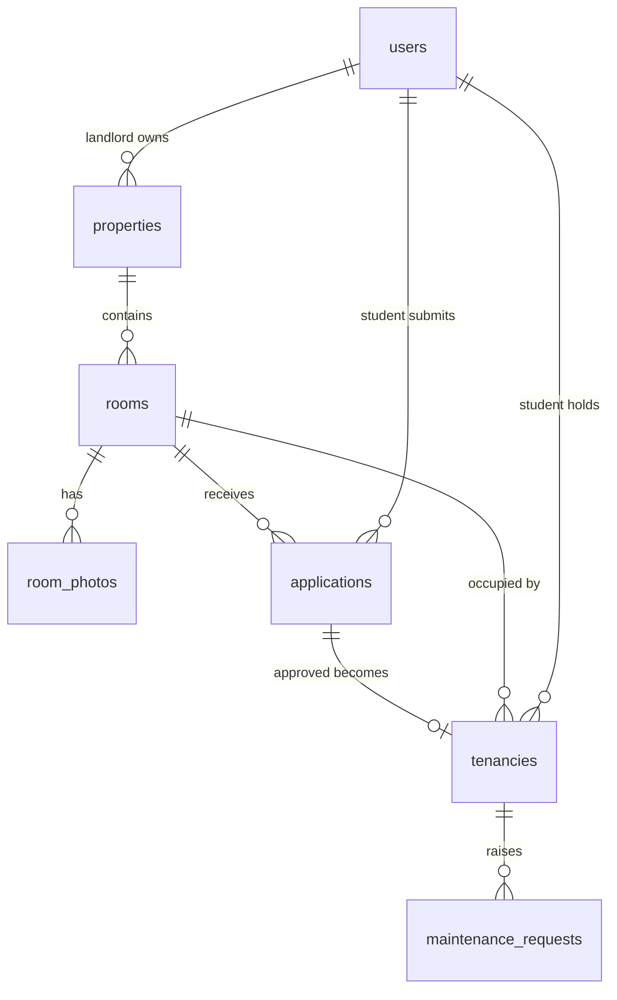

# Data Model – RoomSphere

Draft v0, written by Mitesh Chand Thakur (mitscodes). Database: PostgreSQL on Amazon RDS in a private subnet (see Architecture v0). The SQL is in [`db/schema.sql`](../db/schema.sql).

## Why a relational database

Our records are connected: a student applies for a room, the room belongs to a property, an approved application becomes a tenancy, and a tenant raises maintenance requests. A relational database enforces those links (foreign keys) and keeps the data consistent.

## Entity relationship diagram

## Tables

| Table | Purpose | Data class |
|---|---|---|
| `users` | Landlord and student accounts. `cognito_sub` links a row to the Amazon Cognito identity; `role` mirrors the Cognito group | Confidential |
| `properties` | The landlord's five rental properties | Public (address as advertised) |
| `rooms` | Rooms in a property: rent, status (`available`, `occupied`, `unavailable`), available-from date | Public |
| `room_photos` | S3 object keys for room photos (the files live in a private S3 bucket and are shown through pre-signed URLs) | Public |
| `applications` | A student's request for a room; status moves `submitted` → `under_review` → `approved` / `rejected` (or `withdrawn`). `landlord_note` is internal | Confidential / Internal |
| `tenancies` | Created when an application is approved; links the student to the room with start and end dates | Confidential |
| `maintenance_requests` | Issues raised by a tenant against their tenancy; status `open` → `in_progress` → `resolved` | Confidential |

## Who can do what (enforced by the API using the Cognito group)

| Action | Landlord | Student |
|---|---|---|
| Create / edit properties, rooms, photos | Yes | No |
| View available rooms | Yes | Yes |
| Submit an application | No | Yes |
| View applications | All | Own only |
| Approve / reject an application | Yes | No |
| Submit a maintenance request | No | Yes, only with an active tenancy |
| View / update maintenance requests | All | Own only (view) |

## How this supports the success measures

- Landlord manages five units → `properties` and `rooms`.
- Students register, browse and apply → `users`, `rooms`, `applications`.
- Landlord reviews and updates status → `applications.status`, `decided_at`.
- Tenants raise maintenance requests → `tenancies` then `maintenance_requests`.
- Role-based access → `users.role` plus the Cognito groups `landlord` and `student`.

## Design decisions

- Passwords are not stored. Cognito handles sign-in; the database keeps only the Cognito id.
- A maintenance request must reference a tenancy, so only approved tenants can raise one.
- Database credentials are kept in AWS Secrets Manager, never in this repository.
- Not yet decided: lease documents, payments and notifications are out of scope for v0.
